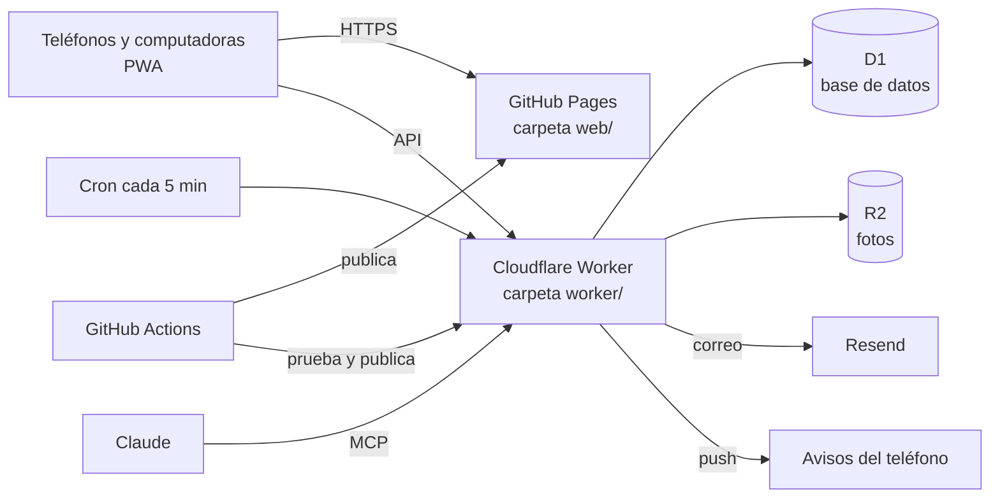

# Control de Hoteles

App para administrar **Hostal Prado Alto** (14 habitaciones) y **ProKinto** (12 habitaciones): recepción, limpieza, problemas de mantenimiento y contabilidad. Cada persona entra con su propio usuario y ve solo lo que le corresponde.

Se instala en el teléfono como una app (PWA), funciona en iPhone, Android y computadora, y avisa con notificaciones push.

## Qué hace

| Rol | Qué ve y qué puede hacer |
|---|---|
| **Dueño** | Panel global de todos los hoteles: habitaciones libres, ocupadas, por limpiar y con problemas; ingresos de hoy, semana y mes; órdenes de compra pendientes. Crea usuarios y asigna roles. |
| **Administración** | Todos los roles dentro de su hotel. |
| **Recepción** | Tablero de habitaciones, entradas por noche o por hora, extensiones, salidas, caja del día y otros ingresos. No ve la contabilidad semanal. |
| **Limpieza** | Lista de habitaciones por limpiar con botones *Empezar* y *Terminé*. Recibe un aviso cuando un huésped sale. No ve nombres de huéspedes ni dinero. |
| **Mantenimiento** | Problemas reportados (con foto) y marcarlos como resueltos. |
| **Contabilidad** | Control semanal por día y forma de pago, por recepcionista, órdenes de compra, movimientos y descarga en CSV. |

**Automático**
- **Salida a las 11:00 a. m.** (configurable por hotel): la estadía termina sola, la habitación pasa a *Por limpiar* y limpieza recibe el aviso.
- **Habitaciones por hora** (solo Prado Alto): avisa a recepción cuando vence el tiempo; la salida se registra a mano.
- **Órdenes de compra** (solo Prado Alto): aviso para facturar a los 15 días y alerta a los 30 días sin cobrar.
- **Fecha y hora de Honduras** en todo: la caja del día cambia a medianoche local.

**Seguridad**
- Entrada con **código por correo** (6 números, vence en 10 minutos) y luego con **huella o Face ID** (llaves de acceso / passkeys).
- Permisos revisados en el servidor en cada acción, no solo en la pantalla.
- Anular un cobro exige motivo y queda registrado; nada se borra. Bitácora de cada acción.

**Claude (MCP)**: el dueño crea un token y conecta la app a Claude para preguntar cosas como *"¿cómo fueron las ventas de Prado Alto esta semana comparadas con la anterior?"*. Ver [docs/MCP.md](docs/MCP.md).

## Cómo está hecha



- **web/**: la app (HTML, CSS y JavaScript sin dependencias), service worker y manifiesto.
- **worker/**: la API en Cloudflare Workers, base de datos D1, fotos en R2, tareas automáticas y servidor MCP.
- **.github/workflows/**: publicación automática al hacer *push* a `main`.

> Las fotos se guardan en **R2**, el almacenamiento de archivos de Cloudflare; **D1** guarda los datos y la referencia a cada foto. D1 no está hecha para guardar imágenes.

## Puesta en marcha

Sigue la guía paso a paso: **[docs/PUESTA-EN-MARCHA.md](docs/PUESTA-EN-MARCHA.md)**. Toma unos 30 minutos la primera vez.

## Probar en tu computadora

Necesitas Node.js 22.

```bash
# Pruebas automáticas de la API (16 escenarios)
cd worker && node --experimental-sqlite --test test/api.test.mjs

# App y API locales con datos en memoria
node --experimental-sqlite worker/test/dev-server.mjs
# Abre http://localhost:8080 y entra con alexis@example.com (el código aparece solo)
```

## Próximos pasos

Ver [docs/HOJA-DE-RUTA.md](docs/HOJA-DE-RUTA.md): Telegram, delegación de tareas, reservas futuras y reportes mensuales.
